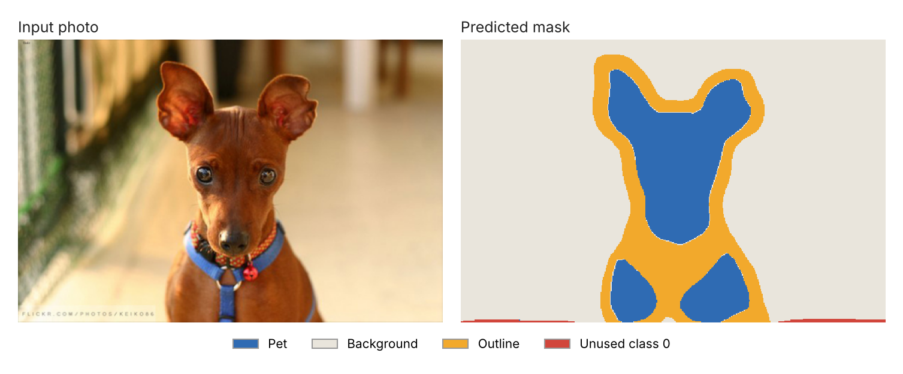
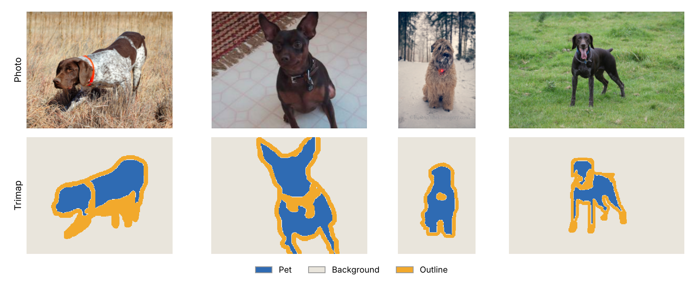

# Pet Segmentation on Amazon SageMaker

I trained a model to separate pets from their background, pixel by pixel, using SageMaker's built-in semantic segmentation algorithm. The point of the project was the full managed lifecycle on AWS. Data goes into S3, training runs on a GPU instance, predictions come from a live endpoint, and the endpoint gets shut down when the work is done.

## Results

After 10 epochs, scored on a 25% validation split.

| Metric | Value |
|---|---|
| Pixel accuracy | **0.925** |
| Mean IoU | **0.606** |

Pixel accuracy looks great mostly because background fills most of every image. Mean IoU is the more honest number, since it weighs each class equally, including the thin outline around the pet that is hard to get exactly right.

## How it works

1. **Data.** The [Oxford-IIIT Pet Dataset](https://www.robots.ox.ac.uk/~vgg/data/pets/), 7,390 photos of cats and dogs. Each one comes with a trimap that labels every pixel as pet, background, or outline.
2. **Split.** A random 75/25 split into training and validation, giving 5,522 training images.
3. **Staging.** Images and annotations uploaded to S3 as the four channels SageMaker expects (`train`, `train_annotation`, `validation`, `validation_annotation`).
4. **Training.** SageMaker's built-in algorithm with an FCN head on a pretrained ResNet-50 backbone, on one `ml.p3.2xlarge` instance. RMSprop, learning rate 1e-4, poly scheduler, batch size 16. The job billed under 30 minutes.
5. **Serving.** Deployed to a real-time endpoint on `ml.m4.xlarge`. A JPEG goes in and a PNG mask comes back.
6. **Teardown.** The last cell deletes the endpoint so it stops billing.

## What I'd do differently

- **Fix the class count.** The trimaps use labels 1 to 3, but I set `num_classes` to 4. The model ended up with an empty extra class that it still predicts now and then, which is the dark strip along the bottom of the example mask above. Remapping the labels to 0 to 2 and setting `num_classes` to 3 is the first fix.
- **Report IoU per class.** A single mean hides which class is dragging the score down.
- **Use batch transform for one-off predictions.** A real-time endpoint makes sense for live traffic. For scoring a folder of images, a batch transform job is cheaper because nothing sits idle.

## Running it

You'll need an AWS account, a SageMaker notebook instance or Studio, and an IAM role with access to S3. Change `bucket_name` in the notebook to a bucket you own, then run the cells in order. Training and the endpoint both cost money, so make sure the final cell runs and deletes the endpoint.

## Data

Oxford-IIIT Pet Dataset by Parkhi, Vedaldi, Zisserman, and Jawahar (2012), from the Visual Geometry Group at the University of Oxford.

## License

CC0-1.0. See [LICENSE](LICENSE).
